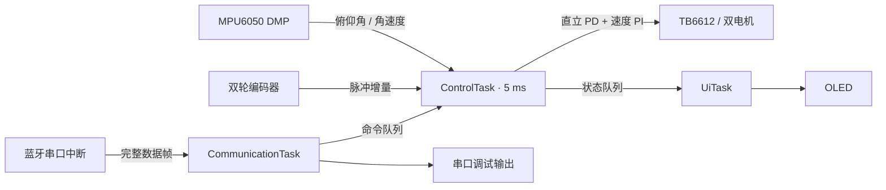

# STM32 + FreeRTOS 两轮自平衡小车

[](https://github.com/SGJ-TXDY/stm32-freertos-balancing-car/actions/workflows/build.yml)

基于 **STM32F103C8T6、HAL 库与 FreeRTOS** 的两轮自平衡小车固件。系统读取 MPU6050 的 DMP 姿态数据与双轮编码器反馈，通过直立 PD、速度 PI 计算双电机 PWM；OLED 显示运行状态，蓝牙串口接收控制指令。

工程保留 STM32CubeMX 与 Keil MDK 的目录结构，并提供 GNU Arm Embedded 构建脚本和 GitHub Actions 自动构建。

## 1. 系统组成

| 部分 | 方案 |
| --- | --- |
| 主控 | STM32F103C8T6，Cortex-M3，72 MHz，64 KB Flash / 20 KB SRAM |
| 实时调度 | FreeRTOS Kernel V10.5.1，1 ms 系统节拍 |
| 姿态采集 | MPU6050，DMP 四元数转俯仰角，200 Hz FIFO 输出 |
| 运动反馈 | TIM2 / TIM3 编码器模式，读取每个控制周期的脉冲增量 |
| 电机驱动 | TB6612，双通道有符号 PWM，输出限幅 ±3600 |
| 状态显示 | SSD1306，128 × 64，I²C 接口 |
| 通信 | USART2 蓝牙收发；USART1 调试输出 |



## 2. FreeRTOS 任务设计

| 任务 | 优先级 | 栈空间 | 调度方式 | 职责 |
| --- | ---: | ---: | --- | --- |
| `ControlTask` | 4 | 384 words / 1536 B | `vTaskDelayUntil`，5 ms 周期 | 姿态读取、编码器采样、控制计算、PWM 输出与状态发布 |
| `CommunicationTask` | 2 | 256 words / 1024 B | 通知唤醒，20 ms 超时复查接收 | 蓝牙帧解析、控制命令入队、串口回复与调试转发 |
| `UiTask` | 1 | 384 words / 1536 B | 刷新后延时 100 ms | 显示俯仰角、编码器增量和电机使能状态 |

- **I²C 互斥**：MPU6050 与 OLED 共用 I²C2，通过带优先级继承的互斥锁协调访问。OLED 数据分成 16 字节的小块发送，控制任务可在块间取得总线。
- **状态快照**：控制任务通过单元素队列覆盖发布最新状态，显示任务读取快照。
- **命令队列**：串口中断只把字节放入环形缓冲，通信任务组帧后入队，由控制任务统一改变电机状态。
- **时基衔接**：SysTick 推进 HAL 毫秒时基与 FreeRTOS 节拍，SVC、PendSV 交由 Cortex-M3 移植层处理，CubeMX 不再生成这两个处理函数。
- **内存管理**：FreeRTOS 使用 `heap_4`，堆容量 10 KB，启用栈溢出与分配失败钩子。

## 3. 控制流程

1. 初始化时钟、外设、OLED 与 MPU6050 DMP，PWM 保持为零。
2. 启动调度器，控制任务周期性读取 FIFO，将 Q30 四元数转换为俯仰角，获取 Y 轴角速度与双轮编码器增量。
3. 计算直立 PD 与速度 PI 输出，叠加并限幅后送入电机驱动。
4. 独立更新显示、处理蓝牙指令与串口调试输出。

控制参数位于 [`pt_pid.c`](cubemx_config/Core/Src/pt_pid.c)：机械零点 `Car_zero`、直立环 `zhili_Kp / zhili_Kd`、速度环 `sudu_Kp / sudu_Ki`。参数应结合车体重心、传感器安装方向与电机极性整定。

电机默认停止。仅在新姿态数据有效、俯仰角距机械零点小于 8° 时接受使能请求；倾角偏离超过 35°、连续 25 ms 无有效姿态数据或控制周期超时，都会停止电机。停止时清除速度积分，恢复运行需重新发送使能指令。

DMP 每次最多读取 4 包，只有确认 FIFO 队尾已读到才发布姿态；达到上限仍有积压或中途读取失败时，不发布旧数据并解除使能。SysTick 另行检查电机输出是否已超过 10 ms 未更新，直接清零 PWM 与方向引脚，因此 I²C 读取、总线恢复或互斥锁等待不会阻塞这一切断路径。该保护依赖 SysTick 中断正常执行，不替代独立硬件保护。

## 4. 硬件连接

| 信号 | STM32 引脚 / 外设 |
| --- | --- |
| MPU6050 与 OLED SCL / SDA | PB10 / PB11，I²C2，400 kHz |
| 蓝牙 TX / RX（主控侧） | PA2 / PA3，USART2，9600 baud，8N1 |
| 调试 TX / RX（主控侧） | PA9 / PA10，USART1，115200 baud，8N1 |
| 左轮编码器 A / B | PA15 / PB3，TIM2 部分重映射 |
| 右轮编码器 A / B | PB4 / PB5，TIM3 部分重映射 |
| 左轮 PWM（固件映射） | PB8，TIM4_CH3 |
| 右轮 PWM（固件映射） | PB9，TIM4_CH4 |
| AIN1 / AIN2 | PB14 / PB15 |
| BIN1 / BIN2 | PB13 / PB12 |
| 下载与调试 | PA13 / PA14，SWD |

MPU6050 与 OLED 的 7 位地址分别为 `0x68` 和 `0x3C`。I²C 上拉接 3.3 V；电机驱动与主控共地，TB6612 的 STBY 保持有效电平。编码器引脚复用了 JTAG 引脚，工程已关闭 JTAG、保留 SWD。

配套图纸位于 [`hardware/`](hardware/)，首次调试步骤见 [`docs/bring-up.md`](docs/bring-up.md)。

## 5. 获取与构建

```bash
git clone https://github.com/SGJ-TXDY/stm32-freertos-balancing-car.git
cd stm32-freertos-balancing-car
```

### GNU Arm Embedded

准备 Python **3.9+** 与 GNU Arm Embedded 工具链，将 `arm-none-eabi-gcc` 所在目录加入 PATH：

```bash
python scripts/check_project.py
python scripts/build.py
```

Windows 也可显式指定编译器目录：

```powershell
python scripts/build.py --toolchain "C:\path\to\arm-toolchain\bin"
```

脚本从 Keil 工程读取 C 源文件清单，使用 GNU 启动文件与链接脚本，按 **64 KB Flash / 20 KB SRAM** 检查空间。输出位于 `build/`：

| 文件 | 用途 |
| --- | --- |
| `balancing-car.elf` | 带符号调试固件 |
| `balancing-car.hex` | 烧录文件，包含地址信息 |
| `balancing-car.bin` | 二进制固件，烧录起始地址 `0x08000000` |
| `balancing-car.map` | 链接布局与内存占用分析 |

GitHub Actions 对每次推送执行结构检查和固件构建，提供上述文件作为构建附件。编译检查验证构建与内存布局；车体控制效果通过实际接线和参数整定确认。

### Keil MDK

打开 [`cubemx_config/MDK-ARM/cubemx_config.uvprojx`](cubemx_config/MDK-ARM/cubemx_config.uvprojx)，使用 **Arm Compiler 6** 与 STM32F1 设备支持包构建。FreeRTOS 源文件、头文件路径和 Cortex-M3 移植层已加入工程。

`cubemx_config.ioc` 用于查看外设与引脚配置。任务、调度器时基和总线锁由应用代码维护；重新生成 CubeMX 代码时需保留这些接入点，见 [`docs/architecture.md`](docs/architecture.md)。

## 6. 蓝牙指令

使用 `$` 开头、`#` 结尾的 ASCII 帧，不需要换行符。可以连续发送多条帧。

| 指令 | 动作 |
| --- | --- |
| `$ARM#` | 请求使能闭环控制，控制任务检查姿态条件后执行 |
| `$STOP#` | 请求停止电机并清除速度积分 |

`OK:QUEUED` 表示命令已入队，实际使能状态以 OLED 的 `ARMED / STOPPED` 为准。队列满时回复 `ERR:BUSY`，其他完整指令回复 `ERR:COMMAND`。收到的完整帧同时转发到 USART1，便于串口终端调试。

## 7. 目录结构

```text
.
├── cubemx_config/
│   ├── Core/Inc/                   # 应用接口、控制参数、FreeRTOS 配置
│   ├── Core/Src/                   # 三任务、驱动、控制算法、外设初始化
│   ├── Drivers/                    # STM32 HAL 与 CMSIS
│   ├── Middlewares/Third_Party/FreeRTOS/
│   ├── MDK-ARM/                    # Keil 工程
│   ├── GCC/                        # GNU 链接脚本与运行库堆支持
│   └── cubemx_config.ioc            # CubeMX 外设配置
├── docs/                           # 架构与硬件调试说明
├── hardware/                       # 配套图纸
├── scripts/                        # 项目检查与固件构建脚本
└── .github/workflows/               # 自动构建
```

## 8. 依赖与来源

应用基于提供的 STM32 平衡车工程整理，保留原有驱动接口与第三方版权信息。FreeRTOS 内核取自官方固定版本 [V10.5.1](https://github.com/FreeRTOS/FreeRTOS-Kernel/tree/V10.5.1)，随仓库提供构建所需源文件。组件说明见 [`THIRD_PARTY_NOTICES.md`](THIRD_PARTY_NOTICES.md)。
